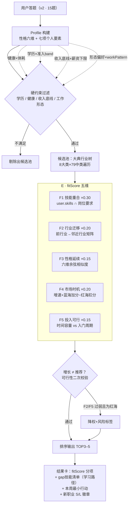

# 岗位推荐系统 v2 · 判断依据与要素关联推理

> **v4 实施状态（2026-11）**：已落地 8 大类 × 180 个 L3 岗位（`js/jobs.js`）与 203 个城市（`js/cities.js`）。推荐改为「多原型候选池 + 城市/本地产业修正 + 稳健/成长/上限三条路线」，不再输出 TOP3 排名。下文 v2 的 32/120 岗与五维打分是早期设计，保留作判断依据背景；当前字段与口径以 `js/jobs.js`、`js/app.js`、`README.md` 为准。

> 状态：设计稿（待确认）。配套 [职业库重构](../../README.md) 实施。
> 数据来源见文末。结论先行：**"三百六十行各细分"不靠手写一万个岗位，靠
> 「官方分类骨架 × 用户要素过滤 × 市场信号加权」三层生成**。

---

## 一、调研结论（判断依据的事实底座）

### 1. 官方分类骨架是现成的
《中华人民共和国职业分类大典（2022 年版）》：**8 个大类 / 79 个中类 / 449 个小类 / 1639 个职业**，
其中数字职业 97 个（S 标注）、绿色职业 134 个（L 标注）。2019 年起人社部建立新职业发布制度，
已累计发布 **8 批 121 个新职业**（含 2025 年第七批的养老服务师、无人机群飞行规划员、装修管家，
2026 年第八批的数字孪生工程技术人员、具身智能机器人应用技术员、运动数据分析师、微电网管理员等）。
→ **岗位库的骨架直接用大典，行业树按"大类→中类→小类"挂载，新职业带 S/L 标签自动获得热点属性。**

### 2. 市场冷热是结构性的，白领内卷、蓝领紧缺并存
社科院×智联《2025 年人力资源市场趋势分析报告》用「竞争指数」（求职人数/职位数）刻画冷热：
- **红海**：工程管理 248、财务 223、学术科研 196、工程施工 197——建议对求职者降权提示
- **蓝海**：搬家配送 7、在线生活服务 O2O 14、配送理货 8——"有岗无人"，适合容错空间大的用户
- 高增长方向：IVD +63.95%、安全性能工程师 +153.40%、AI 产品经理 +137.74%（月薪 19.5k）、
  算法工程师 +53.68%（月薪 22.5k）
- 脉脉高聘《2025 人才迁徙报告》：AI 岗位量同比 +543%，但新经济整体供需比升至 2.23——
  **"热门"不等于"人人能进"，增长信号要叠加准入门槛再使用**

### 3. "缺工榜"反映的是愿不愿意干，不是能不能干
人社部最缺工 100 职业排行多年由营销员、餐厅服务员、商品营业员、车工、家政服务员等占据；
制造业十大重点领域人才缺口近 3000 万、养老护理持证仅 50 万而需求 500 万+。
→ 缺工信号适合作为"过渡期兜底方向"的加分项，但必须与用户的健康/作息约束交叉验证。

### 4. 学历与经验的门槛在抬高
人事/行政/财务/法务岗本科及以上需求占比 2021→2025 从 31.3% 升到 35.66%，
3 年以上经验要求从 22.88% 升到 27.60%；而 AI 工程师对无经验者占比反升（5.69%→8.80%，抢应届生）。
→ 学历、经验做**过滤**而非打分，且不同岗位的"卡法"完全不同。

---

## 二、岗位库数据模型（大典骨架 × 用户要素）

```js
INDUSTRIES = {
  '06': { cn: '生产制造及有关人员', children: {          // 大类
    '061': { cn: '机械制造基础加工人员', children: {       // 中类
      '0611': { cn: '车工', careers: ['c06061100'] }      // 小类 → 职业
    }}
  }
}

CAREERS = [{
  code: '4-18-03-01',            // 大典编码（唯一、可溯源）
  name: '新能源汽车维修技师',
  arc: 'maker',                  // v1 原型延续（性格层）
  tags: ['S', 'L'],              // 新职业/数字/绿色标注
  require: {
    ageBand: ['18-45'],          // 适龄段
    eduBand: ['高中中专','大专','本科'],  // 学历准入
    health: ['体力中等'],        // 体耗档位
    workPattern: ['车间作业'],    // 工作形态
    skills: ['电工基础','三电诊断','高压安全'],
    transferFrom: [['汽修', .7], ['机电维修', .8]]  // 前行业迁移矩阵
  },
  market: { salary:'8k–20k', growthYoy: 38, competition: 42, shortage: true }
}]
```

**每个职业必须能回答四个问题**（即判断依据的最小单元）：
① 大典里它是什么（编码/标签）→ 可信度
② 它对人有什么要求（学历/健康/年龄/形态）→ 过滤依据
③ 谁最平滑地能干它（前行业迁移矩阵）→ 转型依据
④ 市场上它热不热（增速/竞争/缺工）→ 时机依据

---

## 三、v2 问卷扩展（v1 的 8 题 → 15 题，新增 7 题）

| # | 问题（简） | 写入字段 | 判定用途 |
|---|---|---|---|
| Q9 | 你现在多大年纪 | `age` | 年龄偏好 + 倒班敏感度 |
| Q10 | 最高学历到哪一步 | `edu` | 一票过滤（挂学历要求的岗） |
| Q11 | 过去主要在哪行干 | `industry` | 迁移矩阵匹配 |
| Q12 | 身体状况自评（健康/久坐OK/体力受限/需规律作息） | `health` | 高体耗岗过滤 |
| Q13 | 你手上有哪些能带走的手艺（多选9项） | `skills[]` | 技能重合打分 |
| Q14 | 想要的工作形态（坐班/外勤/倒班/弹性） | `patternPref` | 工作形态匹配 |
| Q15 | 打算在哪个能级的城市 | `cityTier` | 薪资系数 + 竞争指数地域修正 |

总时长仍控在 90 秒内（15 题 × 6 秒）。合规不变：不涉医疗诊断表述。

---

## 四、判定依据：硬过滤 + 五维软打分

### 硬过滤（一票否决，先于打分）
| 条件 | 动作 |
|---|---|
| `edu` < 岗位 `require.eduBand` 下限 | 剔除 |
| `health` = 体力受限/需规律作息 且 岗位体耗 ≥ 该档 | 剔除 |
| 收入底线 > 岗位 salary 下限 且 岗位非高增长蓝海 | 剔除（保底逻辑优先于兴趣） |
| `patternPref` 与工作形态严重冲突（如要弹性却给倒班强排岗） | 剔除 |

### 五维软打分（归一 0–100，加权合成）

| 维度 | 公式（口径） | 权重 | 依据来源 |
|---|---|---|---|
| F1 技能重合 | \|user.skills ∩ career.skills\| / \|union\| | **0.30** | 迁移学习成本可量化 |
| F2 行业迁移 | 矩阵查 `transferFrom[user.industry]`，无则邻近行业中值 0.35 | **0.20** | 同赛道经验溢价 |
| F3 性格延续 | v1 六维与岗位画像余弦相似度 | **0.15** | 兴趣留存预测 |
| F4 市场时机 | log(1+growthYoy)/log(60)×60 + 蓝海(competition<20)加20 − 红海(>150)扣25，缺工封顶+15 | **0.20** | 智联竞争指数+缺工榜 |
| F5 投入可行 | 按 hours 容量与入门周期折算（<6 周满格递减） | **0.15** | 时间预算对齐 |

输出 **TOP3–5**，每张卡附带：`fitScore` 分项雷达 + gap 技能清单（= 学习路径）+ 本周行动。
权重为初始先验，上线后用结果页停留率/复测率 A/B 校准。

### 关键关联规则（推理时不能违背的反直觉处）

1. **增长 ≠ 推荐**：AI 岗增速 +543%，但学历卡 90% 本科、硕士占 1/3——F4 高分必须先过 F2/F5 的可行性校验，否则出现"推荐你够不着的梦"
2. **缺工 ≠ 谁都适合**：营销员连年缺工榜首，但需销售意愿；养老护理缺口大但体力要求高——缺工只给对应 `arc`（连接人/定盘星等）的岗位加分
3. **红海岗位可当跳板**：财务竞争指数 223 但"会计→审计→财税咨询"迁移链成熟，high competition 的岗位在 F4 降权的同时，F2 迁移分给中高——体现"难进但进了路顺"
4. **新职业 S/L 标签**天然适合内容传播：结果页单独一枚"国家认证新职业"徽章，提升晒图价值
5. **收入底线过滤要有例外通道**：高增长/蓝海岗允许给出"过渡性推荐 + 明确风险提示"，不一刀切——保住产品的情绪价值

---

## 五、要素关联推理图



**要素 → 决策点速查**：年龄 → 年龄偏好/倒班降权；学历 → 一票过滤；行业 → F2 迁移矩阵；
健康 → 体耗过滤；可迁移技能 → F1 重合度；工作形态 → 形态过滤；城市能级 → F4 地域修正。

---

## 六、分期落地路线

| 期 | 内容 | 产出 |
|---|---|---|
| P1 | 现有 32 职业补大典编码 + S/L 标签 + market 信号 | 判定依据数据层就绪，旧逻辑平滑迁移 |
| P2 | 行业树扩充至 ~120 岗位（8 大类各有代表行业）+ 新增 7 题 + 五维打分引擎 | 完整 v2 上线 |
| P3 | 岗位模板化生成（同族岗位换参数）逼近"三百六十行"覆盖面 + AI 动态解读 | 规模化的边际成本≈0 |

P1/P2 完全沿用现有零依赖架构（纯前端计分），P3 再评估是否引入后端。

---

## 主要数据来源
- [人社部：2022 年版职业分类大典公示（中国就业网）](https://chinajob.mohrss.gov.cn/h5/c/2022-07-14/356087.shtml)
- [人社部：新版大典净增 158 个新职业](https://chinajob.mohrss.gov.cn/h5/c/2022-10-08/361551.shtml)
- [新华社：新修订的国家职业分类大典正式发布](http://www.news.cn/edu/20220928/2d48f39eb3a44a37aa12cdc05ff98af8/c.html)
- [光明网：19 个新职业正式发布（2024-07）](https://m.gmw.cn/2024-07/31/content_1303807489.htm)
- [埇桥区政府转载：17 个新职业 42 个新工种（2025-07，第七批）](https://www.szyq.gov.cn/grassroots/6623509/162758961.html)
- [新华每日电讯：11 个新职业 23 个新工种（2026-09，第八批）](http://odz.xdkb.net/page/1/2026-09/10/A8/20260910A8_pdf.pdf)
- [潮新闻/智联招聘×社科院：《2025 年人力资源市场趋势分析报告》](https://tidenews.com.cn/news.html?id=3417299)
- [中国日报：脉脉高聘《2025 年度人才迁徙报告》](http://ex.chinadaily.com.cn/exchange/partners/82/rss/channel/cn/columns/h72une/stories/WS693fcfeca310942cc4996c1e.html)
- [重庆日报：全国"最缺工"一百个职业排行发布](https://epaper.cqrb.cn/kjb/2022-05/24/08/cqkjb2022052408.pdf)